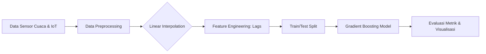
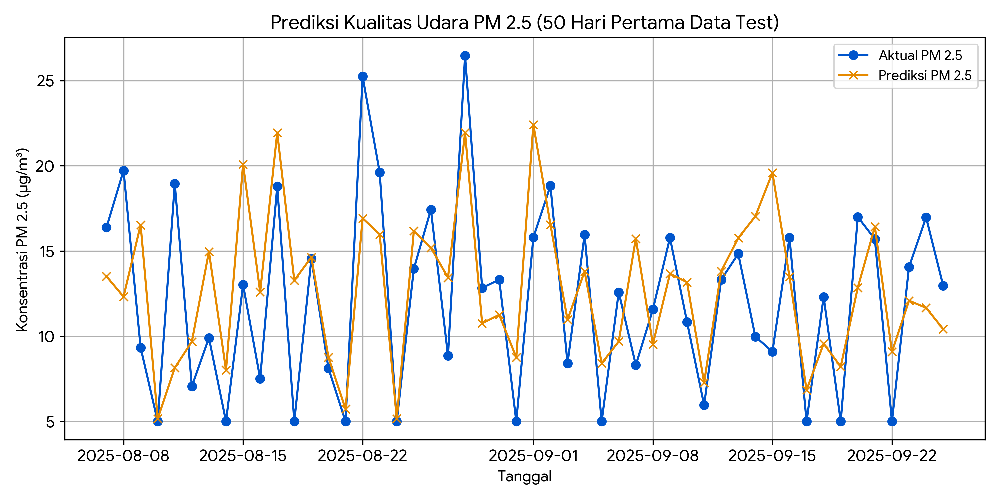

<div align="center">

<h1>☁️ Air Quality (PM 2.5) Prediction</h1>

<h3>Sistem Pemantauan & Prediksi Polusi Udara Cerdas Berbasis Machine Learning</h3>

*Dari data meteorologi historis ➔ prediksi lonjakan polusi PM 2.5 ➔ rekomendasi mitigasi kesehatan publik otomatis.*

<br>

<!-- BAGIAN LOGO / BADGES -->


<br><br>

<!-- MENU NAVIGASI -->
<a href="#-studi-kasus">📖 Studi Kasus</a> • 
<a href="#-piramida-analitik">🔺 Piramida Analitik</a> • 
<a href="#-arsitektur--alur-kerja-crisp-dm">🏗️ Arsitektur</a> • 
<a href="#-cara-menjalankan">🚀 Cara Menjalankan</a> • 
<a href="#-contoh-output--hasil-prediksi">📊 Hasil Prediksi</a>

</div>

<br>

## 📖 Studi Kasus

Proyek ini diinspirasi oleh efektivitas penerapan *High-Performance Computing* (HPC) di Thailand (studi kasus NSTDA) yang dibahas dalam **Informatics Practitioner Lecture Series 2026**.

**Konteks Masalah:**
Kualitas udara yang buruk akibat paparan partikulat halus (PM 2.5) merupakan ancaman serius bagi kesehatan masyarakat. Saat ini, sistem pemantauan di banyak daerah masih bersifat **reaktif**—hanya melaporkan data secara *real-time* setelah masyarakat terdampak polusi. Di sisi lain, prediksi menggunakan model cuaca tradisional sering memakan waktu komputasi yang sangat lama (hingga berhari-hari).

**Tujuan Solusi:**
Membangun kecerdasan buatan (AI) berbasis deret waktu (*time-series*) yang mampu memprediksi konsentrasi PM 2.5 secara cepat dan akurat menggunakan data meteorologi. Model ini memungkinkan otoritas lingkungan dan kesehatan untuk beralih dari pendekatan reaktif menjadi **proaktif**, memangkas waktu analitik, dan memberikan peringatan dini (*early warning system*) tepat waktu.

## 🔺 Piramida Analitik

Proyek ini menerapkan pendekatan analitik *end-to-end* yang bernilai tinggi bagi manajemen instansi pemerintah:

1. **Deskriptif (Apa yang terjadi?):** Sensor IoT di lapangan mencatat fluktuasi data cuaca harian (suhu, kelembapan, kecepatan angin) dan tingkat PM 2.5. Sering ditemukan *missing values* akibat gangguan jaringan sensor.
2. **Diagnostik (Mengapa terjadi?):** Melalui *Feature Engineering*, teridentifikasi bahwa akumulasi polusi dipengaruhi oleh kondisi polusi pada 1-2 hari sebelumnya (*lag variables*), suhu udara yang tinggi, serta lemahnya kecepatan angin.
3. **Prediktif (Apa yang akan terjadi?):** Model `GradientBoostingRegressor` memproyeksikan konsentrasi PM 2.5 untuk beberapa hari ke depan dengan tingkat kesalahan prediksi (MAE) yang sangat minimal.
4. **Preskriptif (Apa yang harus dilakukan?):** Berdasarkan hasil prediksi harian, sistem memberikan basis pengambilan keputusan: Jika prediksi besok melebihi ambang batas aman (>50 µg/m³), sistem merekomendasikan penerbitan imbauan pemakaian masker atau pembatasan aktivitas luar ruangan.

## 🏗️ Arsitektur & Alur Kerja (CRISP-DM)

Sistem ini didesain tangguh dalam menangani permasalahan data dunia nyata, menggunakan *Linear Interpolation* untuk mengisi kekosongan data (*missing values*) akibat *downtime* perangkat IoT.



- **Dataset:** Simulasi deret waktu harian (Suhu, Kelembapan, Kecepatan Angin, Konsentrasi PM 2.5 Historis).
- **Algoritma Utama:** Gradient Boosting Regressor.
- **Evaluasi Performa:** Root Mean Squared Error (RMSE), Mean Absolute Error (MAE), dan Plot Visualisasi Aktual vs Prediksi.

## 🚀 Cara Menjalankan

Ikuti langkah-langkah berikut untuk menjalankan repositori prediksi kualitas udara ini di komputer lokal Anda:

**1. Clone Repositori**
```bash
git clone https://github.com/Muhammadripalrbb/prediksi-kualitas-udara-pm25.git
cd prediksi-kualitas-udara-pm25
```

**2. Instalasi Library (Requirements)**
Pastikan Python sudah terpasang. Buka terminal proyek dan jalankan perintah berikut:
```bash
pip install pandas numpy scikit-learn matplotlib
```

**3. Eksekusi Model**
Jalankan script utama untuk melatih model dan menghasilkan grafik prediksi:
```bash
python kualitas_udara.py
```

## 📊 Contoh Output & Hasil Prediksi

Saat *script* dieksekusi, model akan mencetak metrik tingkat kesalahan prediksi model yang sangat solid:

```text
RMSE: 4.76
MAE: 3.77
```
*Interpretasi Bisnis:* Nilai MAE 3.77 menandakan bahwa tebakan model AI rata-rata hanya meleset sebesar ~3 hingga 4 mikrogram/m³ dari kenyataan di lapangan. 

Sistem juga menghasilkan visualisasi ketat antara fluktuasi aktual PM 2.5 (Garis Biru) dengan proyeksi AI (Garis Oranye).

<div align="center">
  
</div>

---
<div align="center">
  <sub>Dibangun dengan 💻 dan dedikasi untuk penyelesaian masalah lokal melalui teknologi komputasi tingkat tinggi.</sub>
</div>
